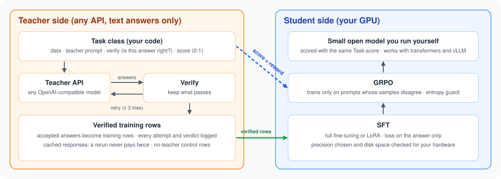
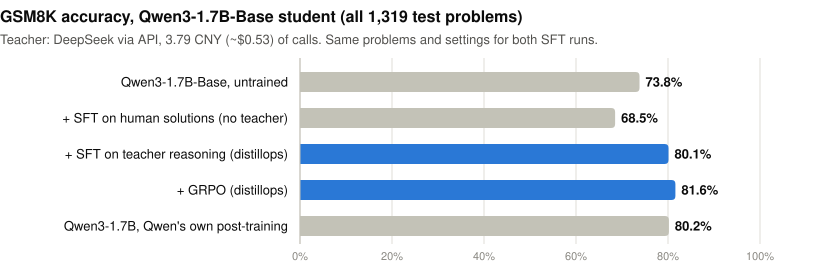

# distillops

**Distil an API LLM into a small open model, for any task with a verifiable answer.**

[](https://github.com/Zihao-Wu06/distillops/actions/workflows/tests.yml)
[](LICENSE)
[](pyproject.toml)

<p align="center"></p>

Under $1 of API calls (3.79 CNY of DeepSeek answers) takes **Qwen3-1.7B-Base from 73.8% to 81.6%** on
GSM8K, on par with Qwen's own post-trained Qwen3-1.7B (80.2%). Training on GSM8K's human-written
solutions to the same problems scores 68.5%: the gain comes from the teacher's verified reasoning.

<p align="center"></p>

You describe a task once, in a `Task` class: its data, prompts, a verifier and a score. The same
commands then collect verified teacher answers, fine-tune, evaluate and run reinforcement learning
(GRPO). Only the teacher's text answers are needed, never its logits, so any API model can teach.

**Three worked examples**, chosen to be very different: math (above), **personal-information
detection**, where a 0.6B student that never trains on a human label beats its teacher (0.955 vs
0.934 F1), and **recommendation**, where an LLM teacher lifts a 0.5M-parameter recommender to the
level of 1.5B-7B LLM recommenders. See [Results](#results).

**Tasks with image inputs** are handled by the [vision extension](extensions/vision/README.md), which
runs the same workflow on prompts that contain images. On receipt photos, a Qwen3-VL-2B student trained on the labels of its
32B teacher, kept only when the receipt's own arithmetic adds up (no human label), ties that teacher
(0.897 vs 0.896 F1). See [Reading receipts](#images-reading-receipts-vision-extension).

**Contents:** [Try it](#try-it) · [What it can be used for](#what-it-can-be-used-for) ·
[How it works](#how-it-works) · [Add your own task](#add-your-own-task) · [Results](#results) ·
[Install](#install) · [Hardware](#hardware) · [Reference](#reference) · [Related work](#related-work) ·
[Layout](#layout)

## Try it
Distil DeepSeek's math reasoning into Qwen3-0.6B-Base on one 24 GB GPU (e.g. an RTX 4090), for under
$1 of API calls. The teacher can be any OpenAI-compatible API: copy the template, set `base_url`,
`model` and `api_key_env`, and export the key.
```bash
git clone https://github.com/Zihao-Wu06/distillops && cd distillops
pip install -e ".[train,dev]"
cp configs/teacher_template.yaml configs/my_teacher.yaml       # then edit it for your provider
export TEACHER_API_KEY=...                                      # the variable named by api_key_env
T=tasks.math.gsm8k:GSM8KTask

python -m distillops eval    --task $T --model Qwen/Qwen3-0.6B-Base --chat-template plain   # 56.8%
python -m distillops teacher --task $T --teacher configs/my_teacher.yaml --n 100            # smoke test
python -m distillops teacher --task $T --teacher configs/my_teacher.yaml                   # all 7,473 problems
python -m distillops sft     configs/sft_qwen3_0.6b_base.yaml
python -m distillops eval    --task $T --model checkpoints/gsm8k_0.6b_base_teacher          # 65.9%
```
**+9.1 points** on all 1,319 test problems (95% CI +6.3 to +11.9). With DeepSeek as the teacher the
calls cost 3.79 CNY (~$0.53); `python -m distillops usage --teacher configs/my_teacher.yaml` reports the
tokens. Measured on an RTX PRO 6000 with GPU memory capped at 24 GB: SFT took 7 minutes and peaked at
14 GB allocated (23 GB reserved); slower cards take longer. The same commands work for your own task
once it has a `Task` class ([Add your own task](#add-your-own-task)); [Results](#results) has the
1.7B route behind the chart above, with GRPO on top.

## What it can be used for
The one requirement: given an input and an output, your code can say whether the output is right
(`verify`, for teacher data) and how right it is on a 0-1 scale (`score`, for evaluation and RL).

| Task type | What `verify` / `score` checks |
|---|---|
| Classification, routing, intent detection | the predicted label equals the gold label |
| Structured extraction (JSON, forms, entities) | the output parses and its fields match |
| Tool / function calling | the function name and arguments match the expected call |
| Code generation | the code passes the task's unit tests |
| Math and quantitative reasoning | the final number equals the answer |
| Short-answer QA | the normalised answer matches |
| Ranking, retrieval, recommendation | the right item appears in the output (e.g. in the top-k) |

Three of these ship as worked examples: **math (GSM8K)**, **personal-information (PII)
detection** (structured extraction) and **recommendation (Amazon)**. They show what the framework does and how well; nothing in the framework
is specific to them. Any other task needs only its own `Task` class
([Add your own task](#add-your-own-task) has a complete one in ~45 lines).

## How it works
```
         ┌───────────────────────────────────────────────────────────────┐
 task ──►│ Task class: data, teacher prompt, verify, training row,       │  the only task-specific code
         │ student prompt, score (+ optional: label-only rows, decoding) │
         └───────────────────────────────────────────────────────────────┘
                                    │
 0 check     python -m distillops doctor     GPU, chosen precision, free memory and disk, versions
                                    │
 1 baseline  python -m distillops eval       the untrained student: the starting point
                                    │
 2 teacher   python -m distillops teacher    any OpenAI-compatible API answers -> verify -> retry the failed
                                             ones (up to --max-attempts, default 3): rejection sampling
   control   python -m distillops labels     rows from the dataset's own labels (answers or human
                                             solutions), no teacher
                                    │
 3 SFT       python -m distillops sft        one run on teacher rows, one on control rows (LoRA by default)
                                    │
 4 eval      python -m distillops eval       teacher SFT vs control SFT vs baseline
                                    │
 5 GRPO      python -m distillops grpo       reward = Task.score; optional --filter-samples keeps prompts that
                                             are sometimes right; validation picks the best checkpoint;
                                             stops on entropy collapse
                                    │
 6 eval      python -m distillops eval       before vs after GRPO
```

`verify` decides which teacher outputs become training data; `score` is both the evaluation metric
and the GRPO reward, so reinforcement learning optimises exactly what you report.

### Features
- **Any verifiable task, one class.** Teacher calls, rejection sampling, SFT, evaluation and GRPO are
  shared; a task only supplies data, prompts, a verifier and a score.
- **Any student model.** Any causal LM from the Hugging Face hub or a local path can be the student
  (Qwen, Llama, Mistral, Gemma, Phi, GPT-2, ...), including base models, with or without a chat
  template of their own.
- **Verified data, measured value.** Teacher outputs are kept only if they pass your verifier (failed
  examples are retried), and a no-teacher control (`labels`) shows what the teacher actually adds.
- **RL that tells you when it will not work.** Before GRPO, the share of prompts that carry a learning
  signal is measured and explained; during and after it, validation on prompts the model never trained
  on picks the best checkpoint, an entropy guard stops collapse, and a weight-change check catches
  updates that never landed.
- **Runs on the GPU you have.** Precision is chosen from the hardware, batch sizes from free memory and
  the model's size, and disk space is checked before training; `doctor` reports all of it.

## Add your own task
A complete task: support tickets classified into a fixed label set, with the teacher explaining its
choice. Save it as e.g. `my_tasks/triage.py`.

```python
import json
import re

from distillops.task import Task, Verdict

class TicketTriage(Task):
    name = "triage"
    LABELS = ["billing", "bug", "feature", "other"]

    def load_examples(self, split):  # any source; here JSONL rows {"id", "text", "label"}
        with open(f"data/triage_{split}.jsonl", encoding="utf-8") as f:
            return [json.loads(line) for line in f]

    def example_id(self, ex):
        return ex["id"]

    def teacher_messages(self, ex, attempt):
        return [{"role": "user", "content": f"{ex['text']}\n\nExplain in one or two sentences which "
                 f"team should handle this, then end with: LABEL: <one of {', '.join(self.LABELS)}>"}]

    def parse_teacher(self, ex, text):
        found = re.findall(r"LABEL:\s*(\w+)", text)
        return found[-1].lower() if found else None

    def verify(self, ex, parsed, text, attempt):
        if parsed not in self.LABELS:
            return Verdict(False, "parse_error")
        return Verdict(parsed == ex["label"], "ok" if parsed == ex["label"] else "wrong_label")

    def sft_example(self, ex, parsed, text):
        return {"prompt": self.student_messages(ex), "completion": [{"role": "assistant", "content": text}]}

    def student_messages(self, ex):
        return [{"role": "user", "content": f"{ex['text']}\n\nEnd with: LABEL: <one of {', '.join(self.LABELS)}>"}]

    def score(self, ex, completion):
        return float(self.parse_teacher(ex, completion) == ex["label"])

    def gold_sft_example(self, ex):  # optional: the no-teacher control for `labels`
        return {"prompt": self.student_messages(ex),
                "completion": [{"role": "assistant", "content": f"LABEL: {ex['label']}"}]}
```

```bash
python scripts/check_task.py --task my_tasks.triage:TicketTriage --model Qwen/Qwen3-0.6B  # data, prompts, masked row
python -m distillops teacher --task my_tasks.triage:TicketTriage --teacher configs/my_teacher.yaml --n 50
# then labels / sft / eval / grpo as in Try it
```

The methods, with the included GSM8K example for comparison:

| Method | Purpose | GSM8K |
|---|---|---|
| `load_examples(split)` | your dataset (a `valid` split, if any, is used for GRPO validation) | `datasets.load_dataset("openai/gsm8k")` |
| `example_id(ex)` | stable id (logging, resume, `--exclude`, `--keep-ids`) | `"gsm8k:train:17"` |
| `teacher_messages(ex, attempt)` | prompt for the teacher | question + "end with `ANSWER: <number>`" |
| `parse_teacher(ex, text)` | raw text -> structured answer | steps + final number |
| `verify(ex, parsed, text, attempt)` | **the distillation filter** | number equals gold, length limit |
| `sft_example(ex, parsed, text)` | accepted output -> training row | `<think>steps</think>ANSWER: n` |
| `student_messages(ex)` | the student's prompt | question + answer-format instruction |
| `score(ex, completion)` | metric **and** GRPO reward, in [0, 1] | 1 if the final number is right |
| `gold_sft_example(ex)` *(optional)* | label-only control row | `ANSWER: n`, or the human solution |
| `extra_metrics(examples, completions, scores)` *(optional)* | metrics over the whole set, next to the mean `score` (e.g. macro-F1, BLEU) | - |
| `evaluate(...)` *(optional)* | custom decoding | - (recommendation overrides it with constrained beam search) |

Constructor arguments can be passed on the command line, e.g. `--task-arg max_words=200`.

**Writing a good verifier is most of the work.** Teachers break instructions in ways that would
teach the student the wrong thing (e.g. referring to information only the teacher saw); `verify` is
where those outputs are dropped. Read accepted samples before scaling up. If GRPO's pass-rate filter
reports a sparse reward, a `score` that gives partial credit is the first thing to try.

## Results
The three included examples, chosen to be very different, show what the framework does and
how well; their code lives in `tasks/` and is not needed for your own task.

### Math: GSM8K (Qwen3-1.7B-Base student, all 1,319 test problems)
| Model | Accuracy |
|---|---|
| Qwen3-1.7B-Base, untrained (zero-shot, plain prompt) | 73.8% |
| + SFT on GSM8K's human solutions (same problems and settings, no teacher) | 68.5% |
| **+ SFT on DeepSeek reasoning (rejection-sampled, full fine-tuning)** | **80.1%** |
| **+ GRPO (1 epoch, reward = `Task.score`)** | **81.6%** |
| *Qwen3-1.7B: Qwen's own post-trained model, for reference* | *80.2%* |

Teacher: DeepSeek Flash, 7,274 of 7,473 problems accepted (97.3%), **3.79 CNY**. The student is a base
model, which has seen no post-training on math, so the gain is the distillation's own. Paired over
the 1,319 problems: SFT adds **+6.3 points** (95% CI +3.9 to +8.6, p < 1e-6) and GRPO with the same
verifier as reward **+1.6** more (+0.2 to +3.1, p = 0.046); the result is on par with Qwen's post-trained
Qwen3-1.7B (+1.4, CI -0.8 to +3.6, p = 0.24). Before GRPO, 40.7% of training prompts carried a learning
signal (57.3% were always solved); GRPO ran 96 steps and token entropy went 0.19 -> 0.15 (no collapse).
The no-teacher control (`labels --task-arg label_reasoning=human`, same 7,274 problems, same SFT
settings) scores 68.5%, below the untrained model; the teacher's reasoning beats it by **+11.6 points**
(+9.1 to +14.3, p < 1e-17), so the gain comes from the teacher, not from training on GSM8K problems.
Training is not bit-for-bit repeatable on GPUs: an earlier run of the same route gave 78.5% / 80.4%
(no significant difference from these numbers). The smaller [Try it](#try-it) route, Qwen3-0.6B-Base
with the same teacher answers and no GRPO, goes from 56.8% to 65.9%.

#### Reproduce it
The full route behind the chart, with the teacher set up as in [Try it](#try-it). The teacher
answers are the same as there: after Try it, the two `teacher` commands send no requests.
```bash
T=tasks.math.gsm8k:GSM8KTask
TEACHER=configs/my_teacher.yaml
B=Qwen/Qwen3-1.7B-Base

python -m distillops eval    --task $T --model $B --chat-template plain             # baseline: 73.8%
python -m distillops teacher --task $T --teacher $TEACHER --n 100                   # smoke test on 100 problems
python -m distillops teacher --task $T --teacher $TEACHER                           # full train split
python -m distillops sft     configs/sft_qwen3_full.yaml                             # writes checkpoints/gsm8k_1.7b_base_teacher
python -m distillops eval    --task $T --model checkpoints/gsm8k_1.7b_base_teacher   # 80.1%

# GRPO (Linux + vLLM): measure the learning signal first, then train on the useful prompts
python -m distillops grpo configs/grpo_gsm8k_qwen3_1.7b_base.yaml --task $T --filter-samples 8 --filter-only
python -m distillops grpo configs/grpo_gsm8k_qwen3_1.7b_base.yaml --task $T \
         --keep-ids checkpoints/gsm8k_1.7b_base_grpo/pass_rate_kept.txt --epochs 1
python -m distillops eval    --task $T --model checkpoints/gsm8k_1.7b_base_grpo      # 81.6%
python -m distillops usage   --teacher $TEACHER                                     # teacher calls and tokens
```
- **Full fine-tuning, not LoRA:** the base model's chat-template tokens (`<|im_start|>`, `<|im_end|>`,
  `<think>`) were never trained, and LoRA cannot learn embeddings; with LoRA, `sft` stops and says so.
  Full fine-tuning of 1.7B parameters needs ~33 GB plus activations (and vLLM's share during GRPO);
  the results were produced on a 96 GB GPU.
- **Baseline:** a base model is scored with the `plain` template (it has not learned the chat format);
  4-shot prompting scored lower (68.1%), so 73.8% is the baseline.
- **GRPO validation:** SFT saw nearly every training problem, and the few it did not are ones the
  teacher failed, so there is no representative validation set: the config sets `eval_every: 0` and
  GRPO keeps its final model. To select checkpoints instead, set problems apart with
  `--task-arg valid_size=500` on both `teacher` and `grpo`, and turn `eval_every` back on.
- **Teacher:** the included results used DeepSeek (`configs/teacher_deepseek.yaml`); the GSM8K teacher
  calls cost 3.79 CNY (3.74 for the full run, 0.05 for the 100-problem smoke test).

### Personal-information detection: a student that beats its teacher
Find names, contact details, addresses, ID and card numbers, dates and demographics in English text
([OpenPII-1M](https://huggingface.co/datasets/ai4privacy/pii-masking-openpii-1m)) so they can be masked
locally. The teacher (DeepSeek, 3 worked examples) labels 10,000 texts; its answers are accepted by
rules alone (values copied verbatim, plausible formats, no long number left unmasked), with no gold
labels. A Qwen3-0.6B student then learns from them, and GRPO uses per-text F1 as the reward.

| Model (2,000 test texts, 7 categories) | Labelled texts used | Mean F1 | Personal info left visible |
|---|---|---|---|
| Qwen3-0.6B, untrained | - | 0.158 | 73.1% |
| Teacher (DeepSeek, 3-shot) | 103 (100 to write its instructions, 3 as examples) | 0.934 | 3.0% |
| **0.6B, SFT on rule-checked teacher labels** | **103** (the teacher's; it trains on none) | **0.945** | 2.0% |
| **+ GRPO on a small labelled pool** | **2,100** | **0.955** | **1.9%** |
| 0.6B, SFT on gold labels of all 10,000 texts (control) | 10,000 | 0.982 | 1.1% |

The student beats its teacher (+1.15 points, 95% CI +0.65 to +1.67, p = 4e-5), and GRPO adds +0.95
(p = 1e-9); teacher labels reach 96-97% of what full human annotation gives. Teacher calls: 17.7 CNY.
Per-category scores, the pilot batch that shaped the teacher's instructions, leakage checks and
the commands: [tasks/pii/README.md](tasks/pii/README.md).

### Recommendation: an LLM teacher for a deployable recommender
A task far from math: next-item recommendation on Amazon Industrial & Scientific. A fine-tuned
Qwen3-1.7B recommends well but is too large to serve, so it is used offline as a teacher (item
embeddings + top-3 soft labels) for SASRec. Two ~0.5M-parameter SASRecs then reach **HR@10 .164 /
NDCG@10 .119**, on par with recent LLM recommenders (1.5B-7B parameters, HR@10 .159-.163) at ~1/1,500
of their serving size. Tables, cold-start results and the commands to reproduce:
[tasks/rec/README.md](tasks/rec/README.md).

### Images: reading receipts (vision extension)
A Qwen3-VL-2B student reads receipt photos (CORD-v2) into JSON: items, totals, cash and change. Mean
F1 on 200 test receipts:

| Model | Human labels used | Mean F1 | Receipts read perfectly |
|---|---|---|---|
| Qwen3-VL-2B, untrained | 0 | 0.756 | 10.5% |
| Qwen3-VL-32B teacher | 0 | 0.896 | 41.0% |
| **2B, SFT on the teacher's arithmetic-checked labels** | **0** | **0.897** | **42.0%** |
| **+ GRPO on 200 labelled receipts** | **300** | **0.905** | **49.5%** |
| 2B, SFT on all 800 gold labels (control) | 800 | 0.928 | 58.0% |

The teacher's labels give 82% of the gain that gold labels for every training receipt give (87% after
GRPO). GRPO's mean gain is not significant (p = 0.16), but it reads 15 more receipts perfectly
(McNemar p = 0.004). The extension adds images to every stage (teacher requests, SFT, evaluation, GRPO
with vLLM) without changing distillops. Tables, process notes and commands:
[extensions/vision/vision_tasks/cord/README.md](extensions/vision/vision_tasks/cord/README.md).

### Takeaways
1. A few CNY of verified teacher reasoning replace a model's math post-training: on GSM8K, SFT takes a
   base model +6.3 points and GRPO with the same verifier as reward +1.6 more, matching Qwen's own
   post-trained model of the same size.
2. Always compare against a same-data, no-teacher control (`python -m distillops labels`), not just the
   untrained model, to see what the teacher itself contributes: on GSM8K, SFT on the human solutions of
   the same problems lowered the score (73.8% -> 68.5%) while the teacher's reasoning raised it (80.1%).
3. Labelling every training text is not needed: rules that check the teacher's answers, plus 100
   labelled texts to write its instructions, train a 0.6B PII detector that beats its teacher, and
   2,000 labelled texts for GRPO bring it to 97% of what labelling all 10,000 training texts gives.
4. For latency-bound products, use the LLM as an offline teacher: item embeddings plus soft labels lifted
   SASRec by 22-24% HR@10, and a two-stage recall + re-rank matched recent LLM recommenders, at
   unchanged serving cost.

## Install
```bash
git clone https://github.com/Zihao-Wu06/distillops && cd distillops
pip install -e ".[train,dev]"          # framework, training stack and tests
pip install "vllm==0.11.0"             # only for GRPO and the pass-rate filter (Linux)
python -m distillops doctor            # GPU, chosen precision, free memory and disk, library versions
python -m pytest -q                    # unit tests; no GPU or network needed
```
Python 3.11-3.12. Tested on these setups:

| Machine | Used for | torch | transformers | TRL | PEFT | vLLM |
|---|---|---|---|---|---|---|
| Windows 11, RTX 4090 24GB | teacher calls, SFT, evaluation, SASRec | 2.11 (cu128) | 5.21 | 1.16 | 0.21 | - |
| Ubuntu 22.04, RTX PRO 6000 96GB (and RTX 6000D 84GB) | GRPO, pass-rate filter, SFT, evaluation | 2.8 (cu128) | 4.57.1 | 0.24 | 0.21 | 0.11.0 |
| macOS (Apple Silicon), CPU only | SFT, evaluation and GRPO without vLLM on non-Qwen students (gpt2, SmolLM2-135M-Instruct) | 2.15 | 4.57.1 | 0.24 | 0.21 | - |

vLLM 0.11 needs transformers 4.x; pin `transformers==4.57.1 trl==0.24.0` next to it. The framework
handles the version differences it knows about (warmup arguments, chat-template options).

**Teacher terms of use:** check that your teacher's terms allow training other models on its outputs;
some providers' terms forbid training competing models.

## Hardware
Nothing is tuned to a particular GPU: memory settings are fractions of the card or are sized from
the memory that is free when the run starts.

| Step | Needs |
|---|---|
| `teacher`, `labels`, `usage` | no GPU (API calls and files) |
| `sft`, `eval` | a CUDA GPU; without one they run on the CPU, which is practical only for small models |
| `grpo` with vLLM (default), pass-rate filter | Linux and a CUDA GPU; `use_vllm: false` runs anywhere, more slowly |

Rough GPU memory per billion student parameters, before activations:
- **LoRA SFT:** ~2 GB (base weights in bf16/fp16; the adapter and its optimizer state are small).
- **Full fine-tuning** (`lora: false`; GRPO's default): ~16 GB (fp32 weights, gradients and AdamW
  state). GRPO with vLLM also reserves `vllm_gpu_memory_utilization` of the card for rollouts.
- **Evaluation:** ~2 GB for the weights; the rest goes to the KV cache.

What adapts and what does not:
- Evaluation and GRPO size their batches from free memory and the model's config, and shrink them
  if a batch would not fit. SFT uses `batch_size` as given: if it runs out of memory, lower
  `batch_size` and raise `grad_accum` (same effective batch).
- `doctor` reports the GPU, precision and free memory; training refuses to start if the disk cannot
  hold the run, and GRPO stops at once if vLLM's share of the GPU is not free, naming the setting to lower.
- One GPU per run; multi-GPU launches (`accelerate`, `torchrun`) are not tested.

## Reference
<details>
<summary><b>Commands</b></summary>

`python -m distillops <command> --help` lists every flag. Commands that read a dataset share
`--task module:Class` (or a YAML file with `task:` and `args:`), `--task-arg KEY=VALUE` (constructor
arguments, repeatable), `--split`, `--n` (random subset, 0 = all) and `--seed`.

| Command | What it does | Main flags |
|---|---|---|
| `doctor` | environment report and platform warnings | - |
| `teacher` | teacher outputs -> `verify` -> accepted SFT rows, with retries; a rerun resumes, and refuses a folder made with another teacher, task settings, teacher prompt or task code | `--teacher` (config, required), `--max-attempts` (3), `--out` |
| `labels` | label-only SFT rows from `gold_sft_example` (the no-teacher control) | `--out` |
| `sft` | supervised fine-tuning from a YAML config | `--train_file`, `--output_dir`, `--model`, `--epochs`, `--chat-template` (override the config) |
| `eval` | generate with a student and score with `Task.score` | `--model`, `--max-new-tokens` (512), `--batch` (0 = auto), `--template-arg KEY=VALUE`, `--no-think` (= `enable_thinking=false`), `--chat-template`, `--tag`, `--out` |
| `grpo` | GRPO with `Task.score` as the reward | `--model`, `--filter-samples N`, `--filter-only`, `--filter-gpu-memory` (0.4), `--keep-ids`, `--exclude`, `--epochs`, `--max-steps`, `--eval-every`, `--eval-examples`, `--chat-template`, `--template-arg`, `--output_dir` |
| `merge` | merge a LoRA adapter into its base model | `--base`, `--adapter`, `--out` |
| `usage` | teacher calls and tokens (prompt, provider prompt-cache hits, completion) from the local response cache | `--teacher` (required) |

`grpo` details: `--filter-samples 8 --filter-only` samples 8 completions per prompt with vLLM (same
temperature, length limits and prompt truncation as GRPO), keeps the prompts whose samples differ in
score (the only ones GRPO learns from, with binary or partial-credit scores), prints why the others
were dropped, and writes `pass_rate_kept.txt`; `--keep-ids` then trains on
those prompts in a fresh process. `--exclude <jsonl>` skips prompts whose `meta.id` appears in a file
(e.g. the SFT data). `--epochs E` sets the number of steps so each prompt is seen E times.

</details>

<details>
<summary><b>Configuration (teacher, student model, SFT, GRPO)</b></summary>

Every option has a default and can be changed in the YAML file. Whenever the framework chooses
something itself (micro-batch, precision, validation source), it prints what it chose and why.

### Teacher (`configs/teacher_template.yaml`; `configs/teacher_deepseek.yaml` is a filled-in example)
| Field | Default | Meaning |
|---|---|---|
| `base_url`, `model` | required | any OpenAI-compatible endpoint (hosted API, vLLM, SGLang, ...) and model name |
| `api_key_env` | `TEACHER_API_KEY` | environment variable holding the key (keys never go in config files) |
| `temperature` | 1.0 | > 0 so retries in rejection sampling give different answers; `null` = not sent (models that only accept their default) |
| `max_tokens` | 1024 | per call; `null` = not sent |
| `max_tokens_param` | `max_tokens` | request field for `max_tokens`; OpenAI's reasoning models need `max_completion_tokens` |
| `max_concurrency` | 32 | parallel requests; raise it if your provider allows |
| `timeout_s`, `max_retries` | 300, 6 | per request; retries (exponential backoff) only for network errors, timeouts, replies without a completion, 408/409/429 and 5xx |
| `extra_body` | `{}` | provider-specific request options, passed through unchanged |
| `cache_path` | `cache/teacher.sqlite` | response cache: an identical request to the same endpoint is never sent twice; teachers can share the file (`usage` counts each separately) |

### Student model
Any causal language model can be the student: set `model` in the SFT or GRPO config, or pass
`--model`, to a hub id or a local path. The included configs name Qwen3 only because the example
results used it.
- **Chat template.** Prompts and training rows go through the student's chat template, the same one
  in SFT, evaluation and GRPO. Instruct models bring their own. A model without one (a base model
  such as `gpt2`) gets a plain `User:` / `Assistant:` template whose replies end with the EOS token,
  so the model learns to stop; a notice says so. To choose another, set `chat_template` in the config
  or pass `--chat-template`: `plain`, a Jinja file, or a Jinja string. The template is saved with the
  trained model, so later commands use it without the option.
- **Base models with a chat template.** A base model may ship a chat template whose special tokens it
  never trained (Qwen3-Base: `<|im_start|>`, `<|im_end|>`, `<think>`). LoRA cannot learn those
  embeddings, so `sft` stops with the options instead of training a model that never ends its reply;
  use `lora: false` (`configs/sft_qwen3_full.yaml`). Generation stops at the template's end-of-turn
  token as well as EOS, and both are written to the saved model's `generation_config.json`, so
  transformers and vLLM stop there too.
- **Template options** (`--template-arg KEY=VALUE`, `chat_template_kwargs` in the GRPO config;
  `--no-think` is `enable_thinking=false`) are passed to the template; templates that do not use
  them ignore them.
- **Architectures.** Memory and disk estimates read layer, head and vocabulary sizes under each
  family's own config names (Llama/Qwen, GPT-2, Falcon, ChatGLM, multimodal configs, ...). For a
  model with no attention heads (e.g. a state-space model), generation starts at batch 8 and adapts.
- **No CUDA GPU.** SFT, evaluation and GRPO with `use_vllm: false` run on the CPU (slow, but
  fine for small models); GRPO with vLLM and the pass-rate filter need a Linux GPU.

### SFT (`configs/sft_qwen3.yaml` with LoRA; `configs/sft_qwen3_full.yaml` and `configs/sft_qwen3_0.6b_base.yaml` with full fine-tuning)
| Field | Default | Meaning |
|---|---|---|
| `model`, `train_file`, `output_dir` | required | base model, JSONL of prompt/completion rows, where to write |
| `eval_file` | none | optional JSONL evaluated each epoch |
| `max_length` | 1024 | longer rows are **dropped**, never truncated (the length distribution is printed) |
| `epochs`, `lr` | 2, 1e-4 | 1e-4 suits LoRA; use ~1e-5 for full fine-tuning |
| `batch_size`, `grad_accum` | 8, 4 | per-device batch and accumulation (effective batch 32) |
| `warmup_ratio` | 0.03 | cosine schedule |
| `lora`, `lora_r`, `lora_alpha`, `lora_dropout` | true, 32, 64, 0.05 | LoRA on all linear layers; `lora: false` = full fine-tuning (fp32 master weights) |
| `seed`, `logging_steps`, `save_strategy` | 42, 10, `epoch` | |
| `chat_template` | none | none = the model's own (plain if it has none); `plain`, a Jinja file or string ([Student model](#student-model)) |
| `extra` | `{}` | any TRL `SFTConfig` argument, including ones the framework sets (`report_to`, `lr_scheduler_type`, `gradient_checkpointing`, ...; overrides are printed); arguments with a field above are set through that field |

With LoRA, a merged copy is saved to `output_dir/merged` for evaluation and serving. Each saved model
gets `trained_ids.txt`, the ids of the rows it was trained on (rows from `teacher` and `labels` carry
them), so GRPO never validates on them. Checkpoints hold
weights only and one is kept (`extra: {save_only_model: false, save_total_limit: null}` keeps
optimizer state and every checkpoint); disk space for what will be written is checked before training.

### GRPO (`configs/grpo_gsm8k_qwen3_1.7b_base.yaml`)
| Field | Default | Meaning |
|---|---|---|
| `model`, `output_dir` | required | start checkpoint (the SFT model; `--model` overrides) and where to write |
| `num_generations` | 8 | completions per prompt; the group is the baseline for the advantage |
| `max_prompt_length`, `max_completion_length` | 768, 256 | token limits |
| `temperature` | 1.0 | sampling temperature for rollouts |
| `lr` | 1e-6 | learning rate (full fine-tuning keeps fp32 master weights) |
| `beta` | 0.0 | KL coefficient to the start model (0 = no reference model) |
| `epsilon`, `loss_type` | 0.2, `dapo` | clipping and loss; `extra: {epsilon_high: 0.28}` for DAPO clip-higher |
| `batch_size`, `grad_accum` | 8, 4 | completions per device step and accumulation; the micro-batch shrinks automatically if long completions would not fit, keeping the product |
| `max_steps` | 500 | or set by `--epochs` |
| `use_vllm`, `vllm_mode`, `vllm_gpu_memory_utilization` | true, `colocate`, 0.3 | rollouts with vLLM on the training GPU |
| `lora`, `lora_r`, `lora_alpha`, `lora_dropout` | false, 32, 64, 0.0 | true = LoRA on all linear layers (low-precision base); LoRA usually needs a higher `lr` (~1e-5 to 1e-4) |
| `chat_template` | none | as for SFT; a model trained with distillops already carries its template |
| `chat_template_kwargs` | `{}` | e.g. `{enable_thinking: false}`; prompts are rendered by the framework, so this works with any TRL version |
| `eval_every` | 25 | validation check every N steps (0 = off) |
| `eval_examples` | 200 | validation prompts: the task's `valid` split if it has one, else held out of training (at most 20%); never prompts the start model was trained on (its `trained_ids.txt`): with none left, selection is off and `output_dir` holds the final model; scores are printed with their standard error |
| `eval_patience` | 0 | stop after N checks without improvement (0 = never stop early) |
| `entropy_floor_ratio`, `entropy_patience` | 0.1, 2 | stop when entropy stays below 10% of its starting value for 2 logs (0 = off) |
| `seed`, `logging_steps`, `save_steps` | 42, 5, 100 | |
| `extra` | `{}` | any TRL `GRPOConfig` argument, as for SFT (e.g. `epsilon_high`, `report_to`); checkpoints default to weights only, one kept (`save_only_model`, `save_total_limit`) |

</details>

<details>
<summary><b>Outputs</b></summary>

| Command | Writes |
|---|---|
| `teacher` | `results/<task>/teacher_<split>_n<n>[_<task args>]/`: `run.json` (teacher, task settings, and hashes of the teacher prompt and task code), `accepted.jsonl` (SFT rows), `log.jsonl` (every attempt and verdict; reruns resume from it), `stats.json` (yield, rejection reasons, token usage) |
| `labels` | `data/sft/<task>/labels_<split>_n<n>[_<task args>].jsonl` |
| `sft` | `output_dir/` (LoRA adapter, or the model with full fine-tuning), `output_dir/merged/` (LoRA merged into the model), `trained_ids.txt` in each, `sft_summary.json` |
| `eval` | `results/<task>/eval/<tag>/metrics.json` and `predictions.jsonl` (every completion and its score); `<tag>` defaults to the model folder's name (`<run>-merged` for an SFT model) |
| `grpo --filter-only` | `output_dir/pass_rate_filter.json` (statistics and advice), `output_dir/pass_rate_kept.txt` |
| `grpo` | `output_dir/` = **best model on validation** (a copy of the start model if nothing beat it; the final model when there is no validation), `output_dir/last/` = final model, `trained_ids.txt`, `output_dir/validation.json` (scores per check, best step, weight change, entropy stop) |

</details>

<details>
<summary><b>What the framework handles</b></summary>

- **Teacher client** (`distillops/teacher.py`): any OpenAI-compatible API; configurable concurrency,
  retries with backoff for network errors, rate limits and server errors only, an on-disk response cache
  (a re-run sends no repeated request) and a token counter.
- **Adaptive rejection sampling** (`distillops/rejection.py`): retry only failed examples, up to
  `--max-attempts`; append-only logs so a killed run resumes where it stopped.
- **SFT** (`distillops/sft.py`): TRL, completion-only loss, over-long rows dropped (never truncated),
  LoRA, and a printout of exactly which tokens carry loss.
- **Evaluation** (`distillops/evaluate.py`): batched generation + `Task.score`; tasks can override decoding.
- **GRPO** (`distillops/grpo.py`): `Task.score` becomes the reward, so RL optimises the reported metric;
  pass-rate filter, validation-based checkpoint selection, entropy guard.
- **Hardware-agnostic** (`distillops/precision.py`, `memory.py`, `preflight.py`): precision chosen from
  the GPU, batch sizes from free memory and the model's KV-cache size, disk checked before training.
- **Model-agnostic** (`distillops/chat.py`, `memory.py`): any causal LM; a chat template for models
  without one, and config sizes read under each architecture's field names.

</details>

## Related work
- **Distillation toolkits.** [EasyDistill](https://github.com/modelscope/easydistill) (Alibaba, EMNLP 2025
  demos) covers black-box data synthesis across text, vision-language, text-to-image and text-to-video,
  with outputs for LLaMA-Factory / ms-swift; [DistillKit](https://github.com/arcee-ai/DistillKit) focuses
  on logit-level distillation. distillops is narrower (text tasks, plus image prompts through its
  [vision extension](extensions/vision/README.md)) and goes deeper on the training loop:
  verification-based rejection sampling, no-teacher controls, built-in GRPO and its diagnostics.
  Training itself runs on [TRL](https://github.com/huggingface/trl).
- **LLM recommenders into sequential recommenders:** see [tasks/rec/README.md](tasks/rec/README.md#related-work).

## Layout
```
distillops/       the framework: teacher, task interface, rejection sampling, sft, evaluate, grpo,
                  chat (templates), precision / memory / preflight, cli
tasks/            the three included example tasks (not needed for your own):
  math/           GSM8K, also the reference implementation of a Task
  pii/            personal-information detection (its own README.md): labels, entity parsing and
                  rule checks, F1 and leak rate
  rec/            recommendation (its own README.md): data, SASRec baseline and distillation, prompts, title trie,
                  constrained beams, item embeddings; resources/ holds the SFT user list
scripts/          check_task.py (any task); pii_*.py: the PII example (prepare, rule check, teacher eval);
                  rec_*.py: the recommendation example (prepare, SASRec sweep, build SFT data,
                  LLM / SASRec eval, paired comparison, SASRec distillation, two-stage)
configs/          teacher, SFT and GRPO configs (example settings)
assets/           README figures
tests/            unit tests; no network or GPU needed
extensions/vision/  image prompts (its own README.md, package, configs and tests), with the receipts
                  example in vision_tasks/cord/
```
`data/`, `results/`, `checkpoints/` and `cache/` are created at run time and not tracked.

Data: GSM8K (MIT); OpenPII-1M by Ai4Privacy (CC-BY-4.0); CORD-v2 by NAVER Clova (CC-BY-4.0); MiniOneRec's preprocessed Amazon splits (Apache-2.0) of the Amazon Reviews dataset
(McAuley Lab). Code: MIT.
